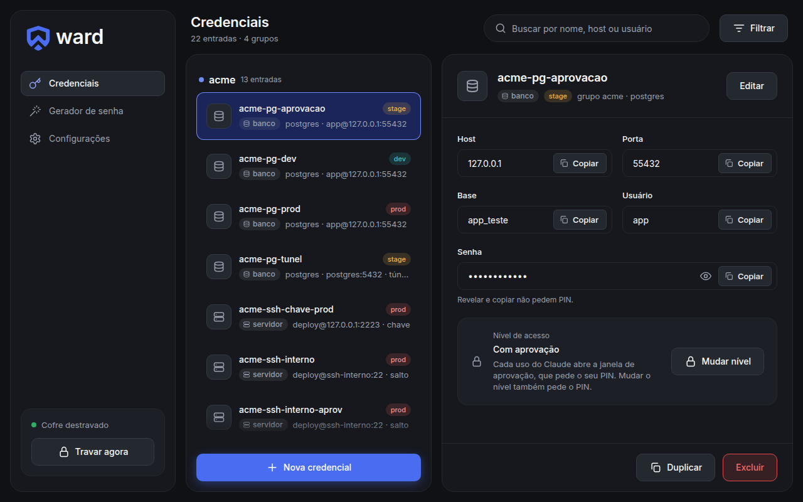
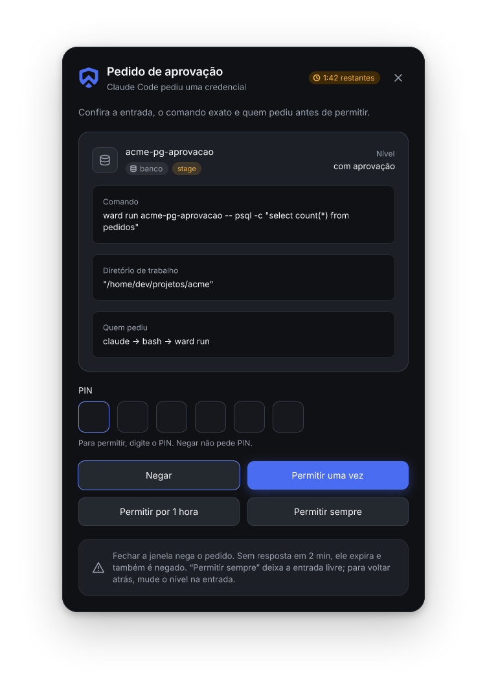
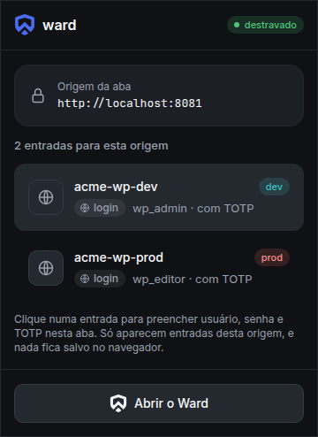
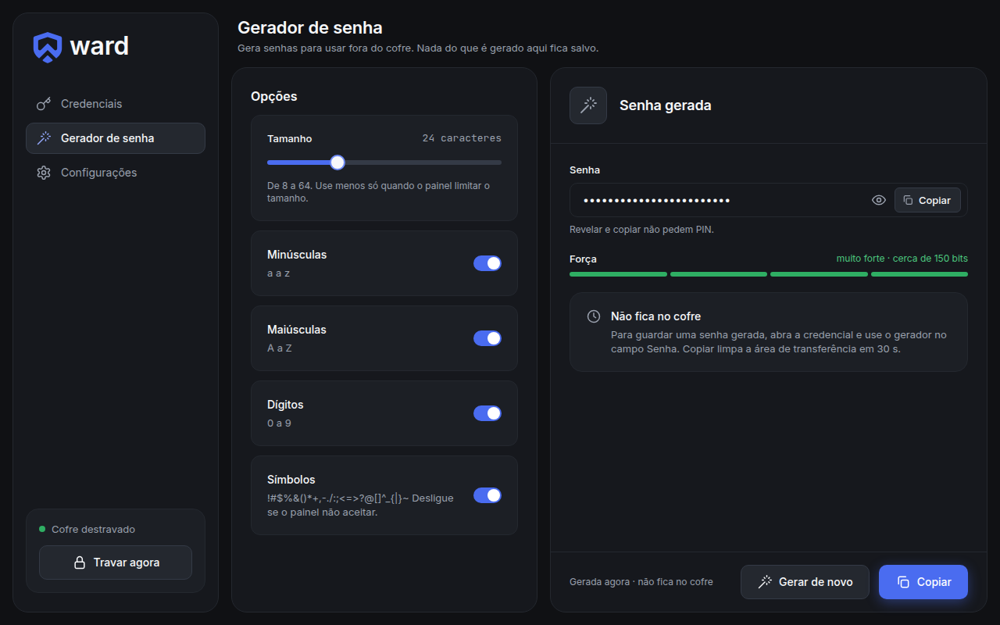

<p align="center">
  <picture>
    <source media="(prefers-color-scheme: dark)" srcset="docs/imagens/logo-escuro.svg">
    
  </picture>
</p>

<p align="center">
  Um cofre de credenciais de trabalho que deixa o Claude usar a senha sem nunca ver a senha.
</p>

<p align="center">
  
</p>

---

Passo o dia com o Claude Code no terminal. Uma hora ele precisa rodar uma query no
Postgres de stage, outra hora entrar por SSH num servidor do cliente, outra testar o
login de um WordPress. Sempre esbarra no mesmo ponto: alguém tem que dar a senha.

Colar a senha na conversa está fora de cogitação. Exportar variável de ambiente no
shell dele dá no mesmo, porque ele consegue ler. Eu usava o KeePassXC com uns scripts
em volta, e funcionava mais ou menos. Cada entrada era montada à mão e cada ferramenta
pedia a credencial de um jeito diferente.

O Ward nasceu para resolver isso. O Claude recebe o **acesso**, nunca a credencial.

## Como fica no dia a dia

O Claude lista o que pode usar e pede para rodar o comando. Quem executa é o daemon do
Ward, com a credencial só no ambiente do processo filho:

```sh
ward lista
ward run acme-pg-dev -- psql -tAc 'select count(*) from pedidos'
ward ssh acme-ssh-chave-prod -- 'systemctl status nginx --no-pager'
ward login acme-wp-prod          # a extensão preenche e envia o formulário na aba
ward playwright acme-wp-prod     # devolve uma sessão logada para o teste
```

A saída volta para o Claude com qualquer pedaço da senha trocado por `••••`, inclusive
em base64, URL-encoded ou dentro de uma `DATABASE_URL`. O código de saída do comando
volta igual. Não existe nenhum comando que devolva o segredo para a CLI, nem para mim.
Revelar e copiar só acontecem no app, na minha frente.

Cada tipo de credencial já sabe como se entregar. Um `banco` postgres vira `PGHOST`,
`PGPASSWORD` e companhia. Uma credencial AWS vira as variáveis `AWS_*`. Um `servidor`
com chave sobe um agente SSH só para aquela conexão, que morre quando ela termina. A
chave privada nunca sai do daemon.

## Você decide o que ele pode usar sozinho



Cada entrada tem um nível:

- **bloqueado**: o Claude nem sabe que ela existe.
- **com aprovação** (o padrão): cada uso abre uma janela com a entrada, o comando
  exato, o diretório e quem pediu (`claude → bash → ward run`). Para permitir, só
  digitando o PIN. Para negar, basta fechar a janela, e se ninguém responder em dois
  minutos o pedido expira sozinho.
- **livre**: ele usa sem perguntar. É para credencial de dev que você não se importa
  que ele veja, e o app avisa isso com todas as letras.

Mudar o nível também pede o PIN. Errou o PIN cinco vezes seguidas, o cofre trava.

O cofre também trava sozinho quando a tela bloqueia, quando o notebook suspende e
depois de 4 horas sem uso. Travar mata o que ainda estiver rodando com segredo, até o
processo que tentou fugir com `setsid`.

<br clear="right">

## No navegador também



A extensão do Chrome sugere as entradas do site aberto e preenche usuário, senha e
TOTP com um clique. Ela só mostra entradas daquela origem e confere o domínio no
daemon, então uma página de phishing parecida com a original não recebe nada.

É a mesma extensão que faz o `ward login` para o Claude. Ela confere o domínio, preenche,
envia e limpa os campos. Se o formulário mandar os dados para outro domínio, se tiver
dois campos de senha ou se o site redirecionar para outro lugar, ela recusa.

Nada fica salvo no navegador.

<br clear="left">

## Um app para cuidar de tudo

O app desktop é feito em Tauri e Svelte, todo em português e com tema escuro.
Credenciais agrupadas por cliente, busca, filtro por tipo e ambiente, anexos, TOTP,
gerador de senha, backup automático com 30 versões, backup opcional em pendrive e um
kit de emergência para imprimir.

<p align="center">
  
</p>

Tipos que já vêm prontos: login, banco (postgres, mysql, mongo, redis, sqlserver, com
túnel SSH opcional), servidor (senha ou chave, com servidor de salto), API, AWS, SMTP,
FTP/SFTP, nota segura e um genérico para o resto. O TOTP é gerado pelo cofre, e o Claude
recebe o código, nunca a semente. Copiar limpa a área de transferência em 30 segundos.

## Por que dá para confiar

Segurança foi o requisito número um do começo ao fim, e na dúvida entre conveniência e
segurança ganhou a segurança. Algumas decisões que saíram disso:

- O daemon `wardd` é o único processo que toca em segredo. CLI, app e extensão são
  clientes dele por um socket que só o seu usuário abre, numa pasta do root.
- O arquivo do cofre é cifrado com XChaCha20-Poly1305, e a chave sai da senha mestra
  por Argon2id (256 MiB, 3 passes). Só bibliotecas auditadas, nada de cripto feita à
  mão. Um byte trocado no arquivo e ele não abre.
- Segredo nunca vai para o disco em claro nem para o argv de um processo. O daemon não
  gera core dump, não aceita `LD_PRELOAD` e zera a memória quando trava.
- O app e o host da extensão são instalados com grupo próprio (setgid), e o daemon
  confere esse grupo antes de responder qualquer coisa. Um processo comum do seu
  usuário fingindo ser o app não recebe nada.
- Tudo fica na sua máquina. Não tem conta, servidor nem sincronização na nuvem.

Não vou fingir que é perfeito. O [escopo](docs/escopo.md) tem uma seção chamada "Fora
do modelo de ameaça" que lista o que o Ward não cobre. Um exemplo: uma entrada "livre"
pode ser lida pelo agente se ele recodificar a variável de um jeito que a máscara não
pega. Ela existe por isso, e eu prefiro que você saiba antes de instalar.

Cada uma dessas regras virou teste. São quase mil testes no `cargo test`, mais suítes
de ataque que sobem SSH, Postgres, WordPress, uma página de phishing e o Chrome de
verdade, sempre com um cofre de teste e credenciais falsas.

## Instalar

O Ward roda no Linux (testado no Pop!_OS 24.04 com Wayland) e precisa do Chrome para a
extensão. Windows e macOS ficam para depois.

Pela [release](https://github.com/jeffersonrucu/ward/releases/latest), com o `.deb`:

```sh
sha256sum -c SHA256SUMS --ignore-missing
sudo apt install ./ward_0.1.0_amd64.deb
```

Ou a partir do código:

```sh
make release
make extensao && make extensao-crx
sudo make install EXTENSAO_ID=<id impresso pelo extensao-crx> EXTENSAO_CRX=$PWD/target/extensao/ward.crx
```

O `sudo` só aparece uma vez, na instalação: ela cria os grupos, instala as units do
systemd e a política do Chrome que instala a extensão. Depois disso, o uso diário não
pede `sudo`. Leia o [roteiro de instalação](docs/instalacao.md) antes, porque ele tem as
conferências do kernel e do Chrome que valem a pena fazer.

Para o Claude Code aprender a usar o Ward, copie a skill de [`skill/`](skill/README.md)
e as regras de deny que vêm junto. Se você está vindo do KeePassXC, o
[guia de migração](docs/migracao.md) faz a troca em etapas, sem perder nada.

## Desenvolvimento

Rust para o núcleo, o daemon e a CLI, Tauri com Svelte para o app e uma extensão MV3
para o Chrome. O `make check` roda fmt, clippy, testes, `cargo audit`, `cargo deny` e o
gitleaks no histórico. O [`CLAUDE.md`](CLAUDE.md) lista todos os alvos do Makefile,
inclusive as suítes de ataque e os serviços de teste.
